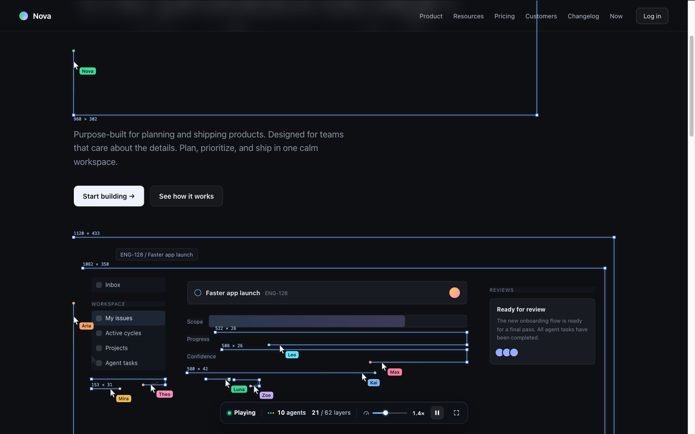
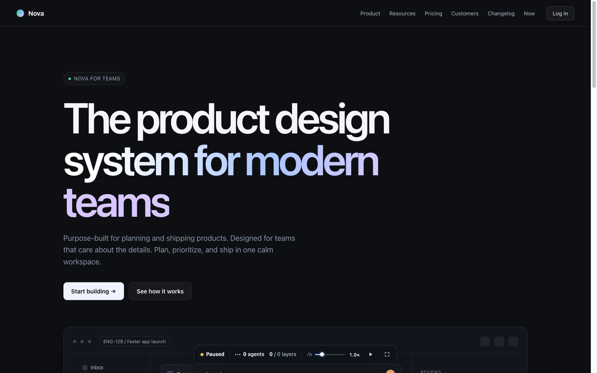
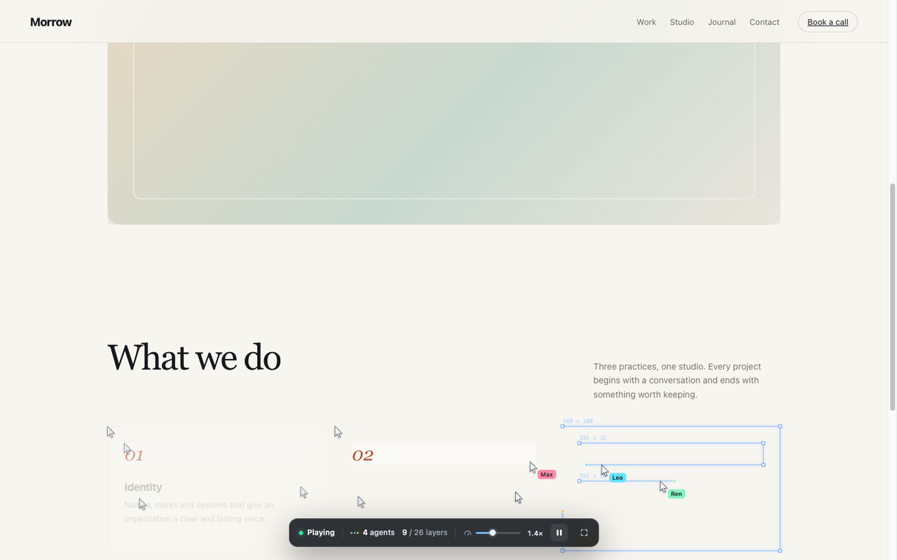
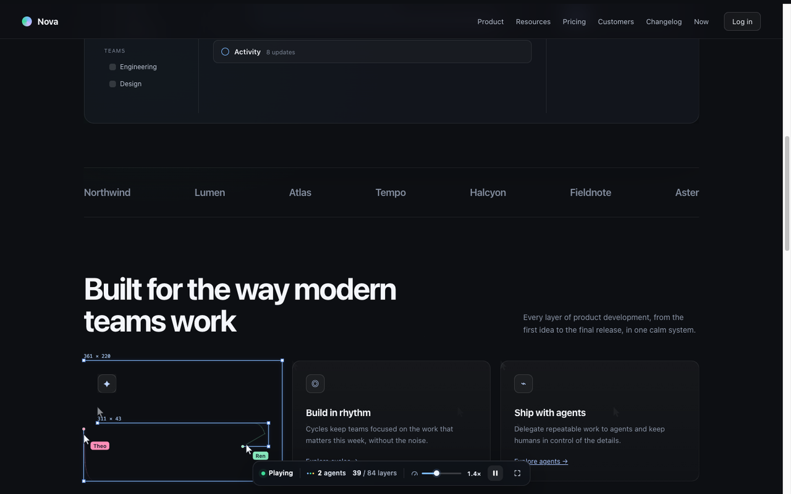
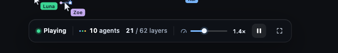

# 网页重绘可视化 / Page Repaint Visualizer

> 多个虚拟 Agent 光标同时工作，把网页内容一层层“画”出来。

一个运行在浏览器里的用户脚本（ScriptCat / Tampermonkey），在任意网页上播放“多 Agent 重绘页面”的视觉效果。

- **默认暂停**：页面先保持正常可见，点击播放后才开始。
- **边框先完成，元素后出现**：绘制期间内容被遮罩覆盖；框画完后边框立即消失，元素再平滑淡入。
- **自动 Agent 调度**：不需要手动设置数量，底栏实时显示当前正在工作的 Agent 数量。
- **可调速度**：底部滑杆同时控制绘制速度和页面滚动速度。



*Agent 正在页面中绘制选框。截图中标题框尚未完成，因此标题仍被遮罩隐藏；框完成后标题才会淡入。*

## 特性

- **从无到有**：页面内容不是先显示再框选，而是由 Agent 绘制完成后才出现。
- **完成即消失**：选框只在绘制过程中存在，不会留下完成的边框。
- **自动 Agent**：根据当前可见工作量自动创建/复用 Agent，空闲 Agent 不显示，最多 64 个并发。
- **统一变速**：一个滑杆控制绘制、光标移动、元素淡入和自动滚动，范围 `0.5×–3.0×`。
- **自动向下滚动**：滚动到页面末尾后自动结束，并淡出遮罩完整显示页面；再次播放可从头重播。
- **浅色 / 深色页面适配**：自动取样页面背景色作为画布遮罩颜色。
- **固定导航保留**：固定/粘性导航作为页面 chrome 保持可见，不会出现闪烁补丁。
- **不侵入页面 DOM**：只添加一个 Shadow DOM 控制条和 Canvas 覆盖层，不改动页面原有内容。
- **Canvas 2D 绘制**：高 DPI 自适应，DPR 上限 2；支持暂停、全屏、Esc 退出全屏提示。

## 预览

### 默认暂停



*默认状态：页面保持完整可见，底栏处于 Paused。*

### 浅色页面



### 滚动到下一屏



### 控制栏



控制栏从左到右依次为：播放状态、实时 Agent 数、已完成 / 总层数、绘制+滚动速度、播放/暂停、全屏。

## 安装

1. 安装 [ScriptCat](https://docs.scriptcat.org/) 或 Tampermonkey。
2. 新建/导入用户脚本，选择仓库中的 [`网页重绘可视化.user.js`](./网页重绘可视化.user.js)。
3. 打开任意 `http://` 或 `https://` 页面。
4. 页面底部会出现控制栏，默认显示 `Paused`；点击播放按钮开始绘制。

脚本使用 `@match *://*/*`，默认在所有页面生效。如果只想在特定站点启用，修改脚本头部的 `@match`。

移除脚本或执行：

```js
PageRepaintVisualizer.destroy()
```

即可立即卸载覆盖层和控制栏。

## 使用

| 控件 | 说明 |
| --- | --- |
| `Paused` / `Playing` / `Done` | 当前播放状态 |
| `N agents` | 当前正在工作的 Agent 数量，自动分配，最多 64 |
| `X / Y layers` | 已完成元素 / 已发现元素 |
| 速度滑杆 + `1.0×` | 同时控制绘制与滚动速度，暂停时也可以先调整 |
| `▶` / `❚❚` | 播放 / 暂停 |
| `⛶` | 进入 / 退出全屏 |

- 播放前可以先调整速度，再点击播放。
- 播放中滚动鼠标滚轮会让自动滚动短暂暂停，方便手动查看。
- 页面到达底部后会自动结束；此时点击播放按钮会回到页面顶部重新播放。
- 速度是页面会话级设置，刷新页面后恢复默认 `1.0×`。

## 工作原理

1. 使用 `IntersectionObserver` 发现可见元素，`MutationObserver` 追踪动态内容。
2. 根据当前可见的待绘制元素数量，自动调度 Agent；Agent 复用，空闲时不绘制。
3. 每个 Agent 移动到一个目标元素，沿元素外框描边；页面整体覆盖一层与背景色一致的 Canvas 遮罩。
4. 描边完成后，选框立即消失，同时在遮罩上按元素区域开洞，元素用 `320ms`（1× 时）淡入。
5. 自动滚动把新内容带入视口；所有动画共享同一个由速度滑杆缩放的时间轴。
6. 到达底部且没有待处理任务时，遮罩淡出，完整显示页面。

实现细节：

- 选框和遮罩全部绘制在 Canvas 上；控制栏位于 Shadow DOM 中，页面 CSS 不会污染样式。
- 固定/粘性元素（导航等）不参与绘制，会在遮罩上方保持可见。
- 文本块带有父子层级保护，标题、按钮等会作为整体绘制，避免“只显示半行”的割裂感。
- 页面内容在绘制完成后才会被洞穿显示，不会提前透出。

## 配置

主要参数位于脚本顶部：

| 常量 | 默认值 | 说明 |
| --- | --- | --- |
| `MAX_AGENTS` | `64` | 最大并发 Agent 数 |
| `MIN_SPEED` | `.5` | 速度滑杆最小值 |
| `MAX_SPEED` | `3` | 速度滑杆最大值 |
| `DRAW_SPEED` | `760` | 描边基础速度（px/s） |
| `BASE_SCROLL_SPEED` | `95` | Agent 工作时的自动滚动速度 |
| `IDLE_SCROLL_SPEED` | `220` | 没有待绘制任务时的滚动速度 |
| `REVEAL_TIME` | `320` | 框完成后元素淡入时长（1× 时，ms） |
| `MAX_OBSERVED` | `8000` | 最多观察的页面元素数量 |
| `RETARGET_COOLDOWN` | `20000` | 同一元素的重复绘制冷却时间（ms） |

默认初始速度在初始化处：

```js
setSpeed(1)
```

## JavaScript API

```js
PageRepaintVisualizer.play()
PageRepaintVisualizer.pause()
PageRepaintVisualizer.toggle()
PageRepaintVisualizer.setSpeed(2)   // 0.5 - 3
PageRepaintVisualizer.destroy()
```

也可以在控制台读取当前状态：

```js
PageRepaintVisualizer.playing
PageRepaintVisualizer.speed
PageRepaintVisualizer.agentCount
PageRepaintVisualizer.drawnLayers
PageRepaintVisualizer.totalLayers
```

## 项目结构

```text
.
├── 网页重绘可视化.user.js
├── README.md
└── docs/
    ├── preview-paused.png
    ├── preview-dark.png
    ├── preview-light.png
    ├── preview-detail.png
    └── control-bar.png
```

预览图片使用本地测试页面截取，与任何第三方产品无关。

## 限制

- 自动滚动基于 `window` / `document`，页面若使用内部滚动容器（某些后台 SPA、虚拟列表）可能无法自动滚动。
- 固定/粘性导航会一直保持可见，不参与重绘。
- 遮罩取页面 `body` / `html` 的背景色；强渐变或背景图片页面可能会有边缘差异。
- 极长页面或复杂应用中，不一定每个元素都会被单独绘制；结束时的淡出会完整揭示页面。
- 脚本默认匹配所有 `http(s)` 页面，并在每个页面显示暂停状态的控制条；如不需要可修改 `@match` 或禁用脚本。
- 性能保护上限：8,000 个观察元素、64 个并发 Agent。

## License

MIT © Micropue
